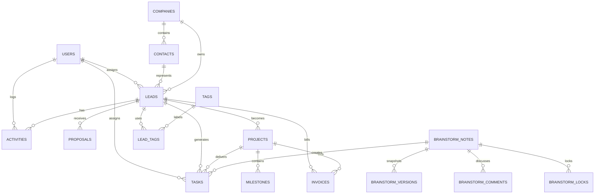

# Momentum Labz CRM Overview

**Written:** 2026-10-13  
**Project version:** `0.1.0`  
**Current branch:** `cleanup-and-overview`  
**Current status:** A working internal CRM application. The production build passes. Lint completes with five warnings. A standalone TypeScript check needs generated Next.js types first. No deployment or live database change was made while this document was written.

This document is a code-based reference. Where the repository does not prove a behavior, it says so instead of guessing.

## 1. Introduction

Momentum Labz CRM is an internal web application for an agency team. It keeps leads, contacts, companies, clients, projects, tasks, proposals, invoices, expenses, follow-ups, notifications, analytics, and brainstorming notes in one place.

It solves the practical problem of running an agency across disconnected spreadsheets, chat messages, documents, and payment notes. The team can move a lead through a pipeline, create a proposal, turn accepted work into a project, track delivery, record costs, and share client-facing proposal and portal links.

The application is built as a Next.js App Router project and uses Supabase for authentication and data. The repository contains migrations from September 2024 through October 2026. The most recent feature milestone is the Brainstorming module and team-management/auth refactor in commit `87f51d1`.

## 2. Quick Start for Team Members

1. Open the CRM URL.
2. Sign in with the email/password form, or request a magic link if that option is enabled for the account.
3. The protected application opens at the Dashboard.
4. Use the sidebar to move between sales, delivery, finance, reporting, settings, and brainstorming.

The application also has public client-facing routes:

- `/proposal/[id]` shows a proposal and allows a client to sign it.
- `/portal/[id]` shows project information and tasks that need client approval.
- `/print/invoices/[id]` renders a printable invoice.

The exact public URL depends on the deployment domain. Local development starts at `http://localhost:3000`.

### Section tour

| Section | Purpose |
|---|---|
| Dashboard | See sales, delivery, finance, follow-up, and notification summaries. |
| Leads | Capture prospects, assign owners, move pipeline stages, log activity, and plan the next action. |
| Tasks | Manage work and follow-ups in a board/list workflow. |
| Proposals | Prepare, send, and track proposals connected to leads. |
| Contacts | Maintain people and company relationships. |
| Clients | View contacts marked as clients and their linked work. |
| Projects | Track client work, milestones, status, ROI figures, and portal tasks. |
| Invoices | Create and track invoices, line items, payment state, and printable versions. |
| Expenses | Record agency costs and whether they are billable or billed. |
| Finances | Review financial summaries across currencies and records. |
| Analytics | Review lead sources, services, pipeline funnel, and lost reasons. |
| Settings | Configure company details, pipeline, services, sources, tags, custom fields, invoicing, FX rates, and team members. |
| Brainstorming | Create rich notes, organize ideas, comment, mention teammates, attach CRM records, convert notes into tasks, and manage note versions. |

## 3. Features

### 3.1 Dashboard

The Dashboard is the signed-in home page. It brings together current CRM activity and summary values. The page reads leads, tasks, proposals, projects, invoices, expenses, notifications, and settings data as needed by the current implementation.

Typical agency uses:

- See which opportunities need attention.
- Review upcoming or overdue work.
- Check proposal and invoice activity.
- Notice unread notifications.
- Move from a summary into a detailed module.

The dashboard supports a period selector. Currency display and financial summaries use the system settings and the current records' currencies. The repository history shows fixes for currency blending and incorrect assignment field names.

Known limitation: the dashboard is a client-rendered operational view, not a separate reporting warehouse. Its numbers depend on current Supabase records and the configured FX values.

### 3.2 Leads

Leads are the main sales record. A lead is connected to a contact and may be connected to a company, assigned team member, tags, activities, proposals, tasks, and a project after winning.

Lead fields visible in the data model and UI include:

- Contact and company
- One or more services
- Region: Bangladesh or international
- Preferred channel: WhatsApp, email, Instagram DM, or call
- Source: Meta Ad Library, Instagram DM, referral, inbound form, cold outreach, or other; the list is configurable
- Pipeline stage
- Deal value and currency: BDT, USD, or AUD
- Demo URL and proposal URL
- Lost reason
- Assigned team member
- Next action type, date, and notes
- Tags

The Leads module provides list and Kanban views, search/filtering, create/edit forms, a detail drawer, CSV-related workflows in the existing implementation, activity logging, next-action controls, and stage movement.

Common workflow:

1. Add a lead and select its contact/company.
2. Choose service, region, source, channel, and owner.
3. Move the lead through the configured stages.
4. Log calls, messages, meetings, notes, or system events.
5. Set the next action and follow-up date.
6. Create a proposal when qualified.
7. Move to Won when work is agreed. The existing code marks the contact as a client and can create a project.
8. Move to Lost with a reason when the opportunity ends.

The database records lead stage history. Renaming a pipeline stage updates lead stage values and history through a database function.

Known limitations:

- Core CRM RLS policies currently allow any authenticated user broad access; role-specific rules are not consistently enforced for leads.
- The lead ingest endpoint is protected by an API key but currently permits wildcard CORS.

### 3.3 Tasks and follow-ups

Tasks connect work to a lead and optionally a project. The model includes title, due time, completion state, assignee, task type, parent task, DRI name, Loom URL, client approval state, comments, and brainstorming-note links.

The Tasks module supports:

- Board-style task movement
- Create/edit modal
- Assignee and lead/project selection
- Due dates
- Completion toggling
- Task types
- Parent/child relationships
- Blockers and decisions through task comments
- Client approval flags
- Tasks created from Brainstorming notes

The agency can use tasks for sales follow-ups, delivery milestones, internal reviews, blockers, and client approvals.

Known limitation: lint reports a missing `fetchData` dependency in the Tasks page. The app build still completes.

### 3.4 Proposals

Proposals are connected to a lead. They store title, amount, currency, services, status, document URL, line items, validity, notes, discount, tax, sent time, and accepted time.

Supported statuses are draft, sent, accepted, and rejected.

Typical workflow:

1. Select a lead.
2. Enter proposal title, services, amount, currency, and optional line items.
3. Save as draft.
4. Share the public proposal link.
5. The client enters a signature name and accepts.
6. The acceptance endpoint creates a draft invoice, marks the proposal accepted, moves the related lead to the Won stage, marks the contact as a client, creates a project where possible, and sends a notification.

Known limitations and risks:

- Public proposal acceptance is reachable without a signed-in CRM session. The current proof is the proposal ID plus a typed signature, not a separate expiring client token.
- Invoice number generation reads the current maximum and adds one. Concurrent acceptances could collide.
- Acceptance performs several writes through the service-role client; partial failure handling is not a database transaction.

### 3.5 Contacts and companies

Companies store name, region, country, website, and creation time. Contacts store company, full name, email, phone, WhatsApp, Instagram handle, client flag, and creation time.

Use Contacts to:

- Create the person behind a lead.
- Link a person to a company.
- Store communication channels.
- Mark a contact as a client after a win.

Use Companies to:

- Group contacts.
- Associate leads and projects with an organization.
- Preserve company-level context for agency work.

Known limitation: company/contact authorization is currently broad for authenticated users because of the original RLS policy model.

### 3.6 Clients

Clients are represented through contacts whose `is_client` value is true, together with their companies, leads, and projects. A separate client table is not present in the committed migrations.

The client view helps the team find active client relationships and connected work. A lead can become a client when moved to Won or when a proposal is accepted.

### 3.7 Projects and client portal

Projects connect a company and lead. They include status, service line, budget, currency, and client-facing ROI fields such as total ad spend, leads generated, and estimated ROI value.

The portal route displays selected project and task information to a client. Tasks can be marked as requiring client approval. The portal approval route validates project and task UUIDs and confirms the task relationship before updating the approval state.

Known limitation: the portal approval endpoint is intentionally public but currently has no separate project access token. Possession of valid identifiers is the access mechanism.

### 3.8 Invoices

Invoices are connected to leads and can be connected to proposals and projects. The current schema and code support invoice number, amount, currency, type, status, gateway, due date, paid date, line items, tax rate, discount amount, notes, retainer month, retainer flag, partial paid amount, and receipt-related workflow.

The invoice page supports creating and editing invoice records, viewing payment state, and opening the print route. The print route formats line items and amounts and has specific handling for BDT lakh formatting.

Known limitation: invoice number generation is not globally serialized in the application code.

### 3.9 Expenses and finances

Expenses store date, description, amount, currency, category, optional lead/project, vendor, payment method, receipt URL, notes, billable flag, and billed flag.

The Finance area summarizes invoice and expense information. FX rates are stored in `system_settings`; the Settings page allows the team to maintain them. The repository history records fixes to prevent mixed-currency summaries and removed tax logic from older flows.

Known limitation: lint reports a missing `fetchData` dependency in Expenses and Finances.

### 3.10 Analytics

Analytics is a client-side summary of current lead data. It calculates:

- Lead totals
- Service distribution
- Source distribution
- Pipeline funnel by stage
- Lost-reason distribution
- Related summary statistics

The stage list is read from the configurable pipeline. Analytics is descriptive reporting over CRM records, not a separate event analytics platform.

### 3.11 Settings

Settings is organized into sections:

- Company profile: name, email, phone, address, website, tax ID
- Currency and FX rates
- Invoice defaults: prefix, year inclusion, default tax rate, payment terms, gateway, footer note
- Lead sources
- Lost reasons
- Services
- Tags
- Pipeline stages
- Custom fields
- Team members and roles
- My account/profile information

Pipeline maintenance supports stage ordering, renaming, and deletion with safeguards. A stage containing leads must be given a replacement stage before deletion. Renaming a service updates stored lead and proposal service names.

Team roles in the committed schema are `owner`, `admin`, `sales`, and `viewer`.

Known limitation: UI roles exist, but most older database policies still treat every authenticated user similarly. Brainstorming has stricter role/object-level policies than the rest of the CRM.

### 3.12 Brainstorming

Brainstorming is a rich internal note workspace. It uses BlockNote and Mantine components.

Features include:

- Create and edit rich notes
- Plain-text extraction for compatibility/search-like summaries
- Team/private visibility
- Pinning
- Status
- Tags
- Links to a contact, lead, or project
- Image uploads to the private `brainstorm-images` storage bucket
- Image cleanup queue for failed deletion cleanup
- Optimistic/local draft recovery behavior
- Edit locks with expiration tokens
- Version snapshots and recent-version restoration
- Comments and threaded replies
- Comment resolution/reopening
- Mentions and notification records
- Convert a note into a task
- Trash, restore, and administrator-only permanent delete
- Mobile and desktop audit scripts in `tests/brainstorming`

Permissions implemented in the Brainstorming migrations:

- Owner/admin: administrative note management and version restoration.
- Owner/admin/sales: note editing.
- Viewer: read-only access.
- Team notes are readable by team members.
- Private notes are readable by their creator and the configured administrator rules.

Known limitations:

- Simultaneous rich-text editing is lock-based, not collaborative CRDT editing.
- The module depends on the newest migrations being applied.
- Some source code uses `any` around BlockNote component APIs because of library typing complexity.

### 3.13 Notifications and email

Notifications are stored in the database and displayed through the top bar. Brainstorming mentions create targeted notifications. The reminder API can send reminders and the email helper uses Nodemailer when SMTP configuration is present.

The scheduled GitHub Actions workflow calls the reminder endpoint using the configured cron secret. The backup workflow creates a PostgreSQL backup artifact using a GitHub secret.

## 4. User Roles and Permissions

The role constraint in the schema is:

| Role | Intended use | Proven behavior |
|---|---|---|
| Owner | Full agency owner access | Full administrative role in Brainstorming and team-management flows. |
| Admin | Operational administrator | Administrative Brainstorming actions and team settings flows. |
| Sales | Sales and note editing | Can edit Brainstorming notes; used for sales operations. |
| Viewer | Read-only team member | Brainstorming read-only behavior. |

The application does not provide one complete, consistent role matrix for every module. The original CRM RLS policies grant broad access to any authenticated user on many tables. Therefore, the table above describes the role model and the strongest role-specific rules currently proven in code, not a claim that every page is fully restricted by role.

## 5. Technology Stack

| Area | Technology | Version/source | Why |
|---|---|---|---|
| Framework | Next.js App Router | `14.2.35` | Pages, layouts, middleware, API routes, and server rendering. |
| Language | TypeScript | `^5` | Type-safe application code. |
| UI runtime | React / React DOM | `^18` | Component rendering and client state. |
| Styling | Tailwind CSS and CSS | `^3.4.1` | Utility styling plus CRM design tokens in `src/app/globals.css`. |
| UI components | Mantine | `^8.3.11` | Used by the rich-text editor integration; direct Mantine package usage should be reviewed before removal. |
| Rich text | BlockNote | `0.55.0` | Brainstorming editor, tables, menus, links, and blocks. |
| Icons | lucide-react | `^1.46.0` | Consistent interface icons. |
| Fonts | Next Inter plus Noto Sans Bengali | Inter via `next/font`; Noto package `5.3.0` | Latin UI font and Bengali editor support. |
| Backend/database | Supabase | `@supabase/supabase-js ^2.116.0` | PostgreSQL access, storage, and server operations. |
| Auth integration | `@supabase/ssr ^0.12.7` | Cookie-aware browser/server session handling. |
| Email | Nodemailer | `^10.0.10` | Optional SMTP reminders/email. |
| Testing | Playwright tooling | `@playwright/test ^1.64.0` | Browser audit scripts and evidence capture. |
| Deployment/tooling | Vercel, Supabase CLI, Wrangler/OpenNext packages | See `package.json` | Deployment and infrastructure tooling. Some Cloudflare packages currently have no direct source/config reference and were not removed under the approved cleanup scope. |
| Automation | GitHub Actions | `.github/workflows` | Database backups and scheduled reminders. |

## 6. Architecture

```mermaid
flowchart TD
  Browser[Team member browser] --> Next[Next.js App Router]
  Next --> Middleware[Supabase session middleware]
  Middleware --> Auth[Supabase Auth]
  Next --> Pages[Protected CRM pages]
  Next --> Public[Proposal and portal routes]
  Pages --> SupabaseClient[Supabase browser/server clients]
  Public --> Admin[Server-only admin client]
  SupabaseClient --> DB[(Supabase PostgreSQL)]
  Admin --> DB
  Pages --> Storage[(Supabase Storage)]
  Actions[GitHub Actions] --> Cron[/api/cron/reminders]
  Cron --> DB
  Cron --> Email[SMTP via Nodemailer]
```

Protected pages use the `(app)` layout and session checks. Public proposal/portal paths are allowed by middleware because clients need to open them without CRM login. The service-role client is used only in server-side routes, but it bypasses RLS and therefore needs careful endpoint authorization.

### Example: creating a lead

1. A signed-in user opens `/leads`.
2. The Lead form collects contact, company, service, source, region, channel, stage, currency, value, owner, and follow-up data.
3. The browser Supabase client writes the lead and related tag records.
4. Database triggers/functions record stage history and update timestamps.
5. The page refreshes the list/Kanban state and shows a toast on success or failure.

### Example: saving a Brainstorming note

1. The user opens a note and obtains an edit lock.
2. BlockNote produces a document JSON value.
3. The save function checks role, visibility, lock token, and optimistic version.
4. A previous version is snapshotted.
5. The note document, plain text, tags, links, status, and version are updated atomically in the database function.
6. If saving fails, the editor keeps a browser draft/recovery path and displays an error.

## 7. Folder and File Structure

```text
src/
  app/
    (app)/                 Protected CRM pages and shared shell
    (auth)/                Login layout and login page
    api/                   Server API routes
    auth/callback/         Supabase auth callback
    portal/                Public client portal
    proposal/              Public proposal view and acceptance
    print/                 Printable invoice route
    fonts/                 Tracked font assets
    globals.css            Global CSS and design tokens
    layout.tsx             Root metadata/font/body layout
  components/
    brainstorming/         Rich note editor and comments
    dashboard/             Dashboard controls
    portal/                Portal actions
    shell/                 Sidebar and top bar
    ui/                    Shared controls, modal, toast, avatar, forms
  lib/
    brainstorming/         Images, types, maintenance
    supabase/              Browser, server, and admin clients
    customFields.ts        Custom-field helpers
    email.ts               SMTP email helper
    errors.ts              Error utilities
    team.ts                Team/user helpers
  types/supabase.ts        Generated-style database type placeholder
supabase/
  migrations/              Ordered database history; do not delete old migrations
  rollback/                Brainstorming rollback SQL
  schema.sql               Original consolidated schema reference
  seed.sql                 Original seed reference
scripts/brainstorming/     Local brainstorming setup/preview scripts
tests/brainstorming/       Browser and migration audit scripts
qa/                        QA reports and feature maps
.github/workflows/         Backup and reminder automation
```

The repository root also contains historical migration/debug scripts and planning documents. They are not application runtime modules. They were intentionally left untouched under the approved cleanup scope.

## 8. Database

### Main tables and columns

The current database is the result of the original schema plus later migrations.

| Table | Main columns and meaning |
|---|---|
| `users` | `id` auth/user UUID; `full_name`; unique `email`; `role`; `created_at`. |
| `companies` | `id`; `name`; region; country; website; created time. |
| `contacts` | `id`; `company_id`; full name; email; phone; WhatsApp; Instagram handle; `is_client`; created time. |
| `pipeline_stages` | `id`; name; sort order; won/lost flags. Names are unique case-insensitively in the settings migration. |
| `leads` | Contact/company links; services; region; channel; source; stage; value/currency; demo/proposal URLs; lost reason; assignee; follow-up fields; next-action fields; timestamps. |
| `activities` | Lead link; channel; direction; summary; logger; activity type; created time. |
| `tasks` | Lead/project links; title; due time; completion; assignee; task type; parent; DRI; Loom URL; client approval; comments/brainstorming ownership fields. |
| `proposals` | Lead link; amount/currency; services; status; document URL; line items; validity; notes; title; discount/tax; sent/accepted times. |
| `tags` | Unique tag name. |
| `lead_tags` | Lead/tag many-to-many junction. |
| `system_settings` | Singleton row with services, currency mapping, company profile, lead sources, lost reasons, FX rates, and invoice settings. |
| `projects` | Company/lead links, name, service line, status, budget/currency, and ROI fields. |
| `milestones` | Project delivery milestones; exact current columns follow the project/task migrations and application usage. |
| `invoices` | Lead/project/proposal links, invoice number, amount/currency, type/status/gateway, dates, line items, tax/discount, notes, retainer and partial-payment fields. |
| `expenses` | Date, description, amount/currency, category, lead/project, vendor, payment method, receipt, notes, billable/billed flags. |
| `lead_stage_history` | Lead stage transition history with previous/current stages and timestamps. |
| `notifications` | Title, message, type, read state, link, recipient, created time, optional Brainstorming note link. |
| `task_comments` | Task link, author/name, content, blocker/decision flags, created time. |
| `brainstorm_notes` | Title, legacy content, BlockNote document, original content, visibility, creator/updater, CRM links, tags, pin/status/version, trash metadata, timestamps. |
| `brainstorm_tags` | Valid Brainstorming tag names. |
| `brainstorm_locks` | Note, user, lock token, expiry. |
| `brainstorm_versions` | Note snapshots, title/document/content, version, creator, created time. |
| `brainstorm_comments` | Note, parent thread, author, body, mentions, resolved state, timestamps. |
| `brainstorm_image_cleanup` | Notes awaiting server-side storage cleanup. |

The repository also references `avatars` storage objects through profile/avatar code. The committed migrations explicitly define the private `brainstorm-images` bucket; other planned buckets are not proven in the migration set.

### Relationships



### RLS and storage

The original CRM tables enable RLS but use an authenticated-user-wide `FOR ALL` policy. This means any signed-in user can broadly read and change many rows. Later settings migrations restrict some functions, and Brainstorming migrations add role-aware and note-aware policies.

The Brainstorming storage bucket is:

- Name: `brainstorm-images`
- Private
- Maximum file size: 5 MB
- Allowed types: JPEG, PNG, WebP, GIF
- Access is controlled by authenticated note-level policies.

### Migration history

| Migration | What it did |
|---|---|
| `20240914000000_init.sql` | Created the original CRM tables, UUID support, timestamps, and broad authenticated RLS. |
| `20240914000001_seed.sql` | Seeded default pipeline stages. |
| `20240914000002_custom_fields.sql` | Added custom-field definitions/values and related support. |
| `20240914000003_phase1_projects.sql` | Added projects and project relationships. |
| `20240914000004_trello_tasks.sql` | Added task-board/task delivery structures. |
| `20240914000005_phase4_analytics.sql` | Added analytics and stage-history structures. |
| `20240914000006_phase4_invoices.sql` | Added invoice structures. |
| `20240914000007_phase5_webhooks.sql` | Added webhook/lead-ingest support. |
| `20240916000000_phase6_features.sql` | Added Phase 6 features such as expenses/notifications and related structures. |
| `20260926000000_capture_adhoc_schema.sql` | Captured fields and tables previously added by one-off scripts, including invoice/proposal fields, expenses, notifications, task comments, and project ROI fields. |
| `20260926000001_settings_hub.sql` | Added configurable settings, pipeline functions, service rename, stage maintenance, and data integrity rules. |
| `20260926000002_restrict_settings_functions.sql` | Restricted settings function execution to authenticated users. |
| `20260926000003_notifications_realtime.sql` | Added notification realtime support. |
| `20261012000000_brainstorming.sql` | Added rich notes, tags, locks, versions, comments, note permissions, storage, and Brainstorming helper functions. |
| `20261013000000_brainstorming_polish.sql` | Added the Brainstorming polish changes present in the migration. |
| `20261013000001_brainstorming_safety.sql` | Added server-maintenance cleanup jobs and guarded save/manage/comment/task functions. |

Old migrations are history and were not deleted.

## 9. Authentication and Security

Login uses Supabase Auth through the browser/server SSR helpers. Middleware refreshes the Supabase session cookie and redirects unauthenticated users to `/login`, except for explicitly public auth, ingest, cron, proposal, and portal paths.

The `(app)` layout performs a server-side user check unless `NEXT_PUBLIC_BYPASS_AUTH=true`. That flag is intended for local QA and must never be enabled in a deployed environment.

Security measures present:

- Supabase cookie session refresh.
- RLS enabled on core tables.
- UUID validation in portal approval.
- Explicit column selection was added in prior portal security fixes.
- Server-only admin client for privileged server tasks.
- Private Brainstorming storage bucket.
- Brainstorming role, visibility, lock, and optimistic-version checks.
- Authenticated-only execution for settings functions.

Known security issues not changed in this cleanup:

- Public portal approval and proposal acceptance rely on public identifiers rather than separate proof-of-possession tokens.
- The admin client uses a service-role key and currently falls back to an empty value if configuration is missing.
- Some Supabase clients contain fallback project configuration, which can hide missing environment setup.
- Original CRM RLS policies are broad for authenticated users.
- Historical QA and scripts mention credential material. Values are not reproduced here. If the repository or history was public, credentials should be rotated and history reviewed.

## 10. Design System

No `design.md` file is present in this repository. The implemented design system is represented by `src/app/globals.css`, `tailwind.config.ts`, shared UI components, and the design references mentioned in the README.

The documented visual rules include:

- Neutral color ramp from neutral-0 through neutral-900.
- Muted gold accent `#C8A84B`.
- Semantic status colors.
- Inter-style UI typography with an eight-step scale.
- Tabular numerals for numeric displays.
- Radius tokens: small 6px, medium 10px, large 16px, full pill.
- Light flat/soft shadows.
- Short 120–220ms ease-out transitions.
- Responsive shell with a desktop sidebar and mobile navigation behavior.

New UI should use existing `Forms`, `Modal`, `Toast`, `EmptyState`, avatar, shell, spacing, color, and typography patterns. Do not introduce a new visual system without an explicit design decision.

## 11. Development History

| Period/commit | Milestone |
|---|---|
| `cc818fb`, 2026-09-16 | Initial CRM: schema, auth, shell, leads, core pages, Supabase integration. |
| `6116780`–`12cafbe`, 2026-09-24 | Leads/proposals updates, API hardening, Brainstorming start, and Phase 6 migration. |
| 2026-09-26 fix series | Repaired settings, schema rebuild, silent save failures, task fields, lead transitions, proposal acceptance, portal behavior, reminders, notifications, printing, and currency handling. |
| 2026-09-26 settings series | Added grouped Settings, configurable pipeline/services/sources/tags/custom fields, company profile, FX, invoice settings, team logins, roles, and account settings. |
| `7259f22`–`5e4b120` | QA documentation and security/currency/portal/print fixes. |
| `87f51d1`, 2026-10-12 | Brainstorming module, team updates, Supabase client refactor, middleware and edge fixes. |
| `b245215`, 2026-10-13 | Safety checkpoint before this cleanup and overview work. |
| This cleanup | Removed only the approved tracked backup seed and Wrangler login log. No redesign or migration deletion. |

## 12. Developer Setup

### Requirements

- Node.js compatible with the installed Next.js 14 toolchain.
- npm.
- A Supabase project for real authentication/data.
- Optional SMTP credentials for email.
- Optional Vercel/GitHub/Supabase CLI access for deployment and database administration.

### Environment variable names

The repository documents these names only:

```text
NEXT_PUBLIC_SUPABASE_URL
NEXT_PUBLIC_SUPABASE_ANON_KEY
SUPABASE_SERVICE_ROLE_KEY
DATABASE_URL
CRM_INGEST_API_KEY
CRON_SECRET
NEXT_PUBLIC_BYPASS_AUTH
```

Copy the example file to a local environment file and fill values locally. Never commit environment files.

### Local commands

```bash
npm install
npm run dev
npx tsc --noEmit
npm run lint
npm run build
npm start
```

The repository does not currently define a package `test` script. Browser audit scripts are run individually with Node/Playwright commands according to their file contents.

### Database setup

The authoritative change history is `supabase/migrations/` in timestamp order. The repository also contains `schema.sql` and `seed.sql` as consolidated/original references. Applying migrations should be done through the project’s normal Supabase workflow; this overview does not run or modify a database.

## 13. Deployment and Hosting

The project documentation identifies Vercel as the hosting platform and Supabase as the database/auth/storage service. GitHub Actions also provide nightly database backup artifacts and a scheduled reminder endpoint ping.

A normal deployment flow is:

1. Push approved code to the connected Git branch.
2. Let Vercel build with the required environment variables.
3. Confirm the build and route output.
4. Apply pending Supabase migrations separately through the approved database process.
5. Confirm auth redirect URLs and public proposal/portal URLs.

The repository does not contain a complete authoritative free-tier cost/limit inventory. Supabase free-tier database size, storage size, bandwidth, project pausing, Vercel limits, and GitHub artifact retention should be checked against the current provider documentation before relying on a zero-cost setup. This document intentionally does not invent limits.

## 14. Testing

Testing assets are mainly under `tests/brainstorming/` and include:

- Design audits for desktop/mobile.
- Editor interaction audits.
- Drag/table/image checks.
- Permissions and deep-link checks.
- Saving/recovery checks.
- Migration audit scripts.
- Helper code and captured screenshots/JSON evidence.

There is also a collection of older root-level manual scripts. They are historical and are not wired into `package.json`.

Validated during this cleanup:

- `npm run build`: passed.
- `npm run lint`: completed with five warnings.
- `npx tsc --noEmit`: initially failed before generated Next.js types existed; after the build generated them, the check passed.
- Live database: not contacted.
- Deployment: not performed.

Full browser coverage for every module, desktop and mobile, was not run as part of this approval-limited cleanup. It remains a follow-up validation task.

## 15. Known Issues, Limitations, and Technical Debt

1. TypeScript checking depends on generated Next.js type directories being present.
2. Lint warnings remain for four `fetchData` hook dependencies and one raw ``.
3. The codebase uses `any` in several pages and rich-editor integrations.
4. There is no package-level `typecheck` or `test` script.
5. The README had been behind the actual feature set; this overview is the more complete reference.
6. Many historical scripts remain at the repository root because only two deletions were approved.
7. Root files mix `.js` and `.mjs` and source formatting is not fully uniform.
8. Public portal/proposal mutations need stronger client access tokens.
9. Core RLS rules are broader than the role model suggests.
10. Proposal invoice numbering and multi-write acceptance need stronger transaction/idempotency handling.
11. Fallback Supabase configuration should fail clearly when required environment variables are absent.
12. Brainstorming uses expiring locks rather than true simultaneous editing.
13. The exact production migration state cannot be verified without connecting to the database, which was intentionally not done.

## 16. Future Roadmap

Suggested next work, ordered by risk:

1. Add proof-of-possession tokens and expiry for portal approvals and proposal acceptance.
2. Replace broad authenticated-user RLS with explicit role/ownership policies for CRM, finance, tasks, and notifications.
3. Make privileged configuration fail closed and remove hardcoded fallback connection values.
4. Make proposal acceptance idempotent and invoice-number allocation database-safe.
5. Add package scripts and CI for typecheck, lint, build, and browser tests.
6. Fix the current lint warnings and easy `any` types.
7. Move historical scripts into a clearly labeled archive or remove them after a separate approval.
8. Add stronger test coverage for every module and responsive layouts.
9. Add real collaborative editing or a deliberate product decision to keep lock-based editing.
10. Keep this overview synchronized with every feature and schema change.

## 17. Glossary

| Term | Meaning |
|---|---|
| App Router | Next.js routing system based on folders, pages, layouts, and server/client components. |
| API route | Server endpoint inside `src/app/api`. |
| Auth | Authentication: checking who a user is. |
| RLS | Row Level Security: database rules that decide which rows a user can read or change. |
| Service-role key | Supabase server credential that bypasses RLS; it must stay server-only. |
| Middleware | Code that runs before a request reaches a page or API route. |
| SSR | Server-side rendering or server-aware session handling. |
| Pipeline stage | A named step in the lead sales process. |
| Lead | A potential client opportunity. |
| Proposal | A commercial offer connected to a lead. |
| Project | Delivery work created for a client/opportunity. |
| Milestone | A meaningful project delivery checkpoint. |
| FX rate | Currency conversion rate. |
| RLS policy | A database access rule. |
| Migration | Ordered SQL change that evolves the database. |
| BlockNote | The rich-text editor library used by Brainstorming. |
| Optimistic version | A number used to detect that someone changed a record before another save. |
| Proof of possession | Evidence that the requester is the intended holder of a private link/token. |

## 18. Changelog of This Document

| Date | Change |
|---|---|
| 2026-10-13 | First complete code-based overview created after the cleanup analysis. It documents the application, current schema/migrations, architecture, permissions, setup, testing status, security limitations, history, and roadmap. |

Update this file whenever a feature, role, migration, environment variable, deployment process, or important limitation changes.
